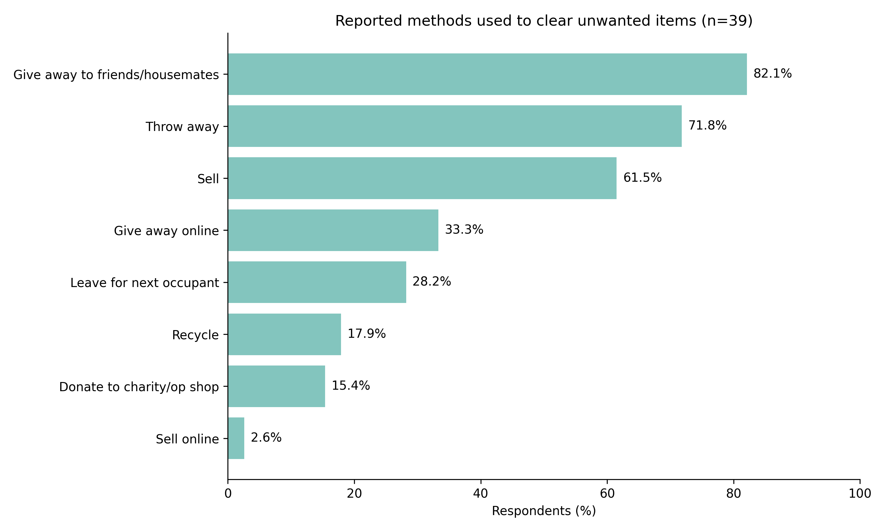
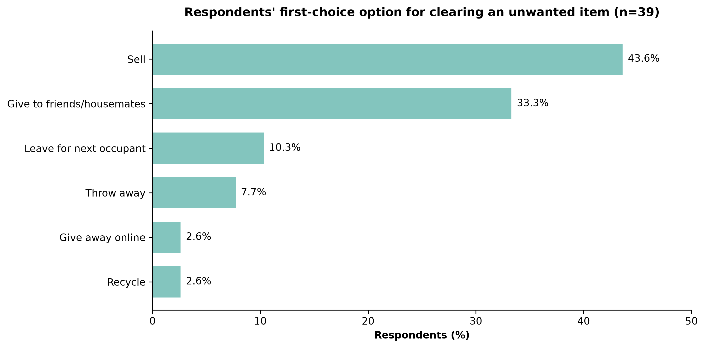
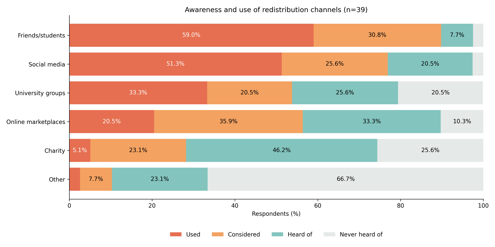
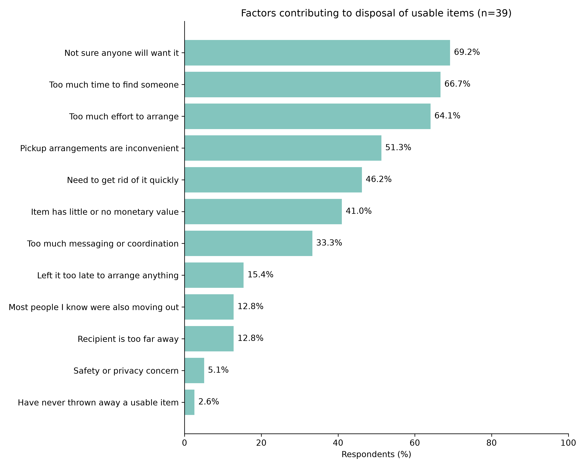
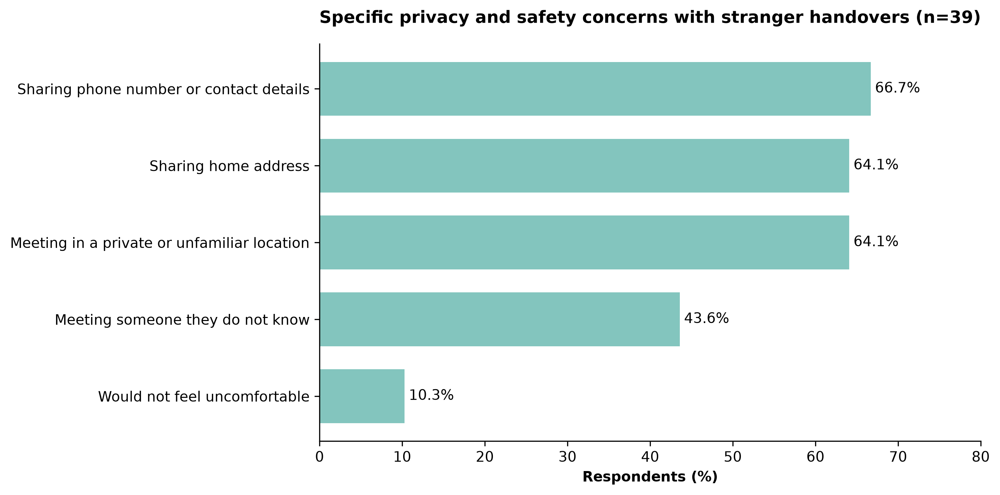
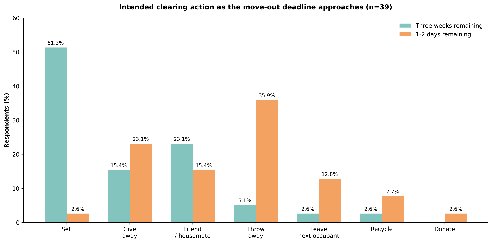

# 📦 University Student Move-Out Item Redistribution: Quantitative UX & Behavioral Research

[](https://www.python.org/)
[](https://pandas.pydata.org/)
[](https://matplotlib.org/)
[]()
[]()

> **Course Project:** INFO3315 Human-Computer Interaction (HCI)  
> **Author:** Reyna Sakura  
> **Focus:** Quantitative Survey Analytics, Behavioral Insights, and Service / UX Recommendations  
> **Detailed Analysis Documentation:** [📑 Survey_Analysis_Notes.md](Survey_Analysis_Notes.md)

---

## Interactive MoveOut Prototype

The research is accompanied by a browser-based prototype covering item listing, handover coordination and urgent redistribution before move-out.

- **[Prototype HTML](prototype/moveout-prototype-m3-revised.html)** — download and open in a browser; no build step is needed.
- **[Prototype README](prototype/README.md)** — setup, three task walkthroughs, interface controls and simulation boundaries.

The latest revision includes consistent bottom-sheet actions, per-item price/size/transport details, and a charity drop-off map with clearly labelled example data.

---

## 📖 Executive Summary

During university move-out periods, vast quantities of functional, usable household goods (kitchenware, appliances, furniture) are discarded into landfills. While university assignments commonly rely on spreadsheets or descriptive summaries, **this project implements an end-to-end, reproducible Python data analysis and visualization pipeline** to uncover the behavioral drivers, channel barriers, and temporal dynamics behind student waste generation.

### 🔍 Key Takeaways
1. **The Intention-Behavior Gap:** While only **7.7%** of students consider throwing items away as their first choice (most preferring to sell at **43.6%** or give to friends at **33.3%**), in practice **71.8% have discarded usable items**.
2. **Coordination & Privacy Friction:** The primary barriers are coordination effort (time to find someone: **66.7%**, coordination fatigue: **64.1%**) compounded by stranger anxiety (sharing phone numbers: **66.7%**, sharing home address: **64.1%**).
3. **The Move-Out Deadline Effect:** As the move-out deadline shifts from **3 weeks** to **1–2 days**, selling collapses from **51.3% down to 2.6%**, while outright disposal surges **7-fold from 5.1% to 35.9%**.

---

## 📑 Table of Contents
- [Interactive MoveOut Prototype](#interactive-moveout-prototype)
- [Executive Summary](#-executive-summary)
- [Research Framework & Questions](#-research-framework--questions)
- [Key Findings & Visual Insights](#-key-findings--visual-insights)
  - [RQ1: Current Behaviour & Channel Awareness](#rq1-current-behaviour--channel-awareness)
  - [RQ2: Redistribution Barriers & Privacy Concerns](#rq2-redistribution-barriers--privacy-concerns)
  - [RQ3: The Move-Out Deadline Effect](#rq3-the-move-out-deadline-effect)
- [Strategic UX & Product Recommendations](#-strategic-ux--product-recommendations)
- [Methodology & Data Pipeline](#-methodology--data-pipeline)
- [Repository Structure](#-repository-structure)
- [How to Reproduce](#-how-to-reproduce)

---

## 🎯 Research Framework & Questions

The research evaluates three core research questions (RQs) focusing on qualified respondents ($N=39$) who previously moved out and had unwanted but functional household items:

| Research Question | Objective | Key Analytical Variables |
| :--- | :--- | :--- |
| **RQ1: Behaviour & Awareness** | How do students currently deal with unwanted items, and how aware are they of existing reuse channels? | `item_disposition`, `first_option`, `channels_awareness` |
| **RQ2: Redistribution Barriers** | Why do students fail to redistribute usable items, and what friction points exist with strangers? | `disposal_reasons`, `stranger_concerns` |
| **RQ3: Deadline Dynamics** | How does time scarcity near move-out deadlines alter disposition decisions? | `intended_action_3weeks`, `intended_action_1to2days` |

---

## 📊 Key Findings & Visual Insights

### RQ1: Current Behaviour & Channel Awareness

#### 1. High Prevalence of Waste Despite Peer-to-Peer Goodwill
Students rely heavily on immediate social circles (82.1% give to friends/housemates). However, informal networks fail to absorb all items, leaving **71.8%** of respondents resorting to dumping usable items.

<p align="center">
  
</p>

*Figure 2: Multi-response distribution of disposition methods used by students ($N=39$).*

#### 2. First-Choice Preference vs. Reality
Students demonstrate a strong initial preference for economic recovery (**43.6%** prefer selling) or social redistribution (**33.3%** give to peers). Throwing items away is rarely a student's preferred first choice (**7.7%**), proving that disposal is an involuntary compromise rather than a deliberate preference.

<p align="center">
  
</p>

*Figure 3: First-choice clearing options when encountering unwanted usable items.*

#### 3. Channel Awareness & Conversion Funnel
While online marketplaces and charity channels have high brand awareness (**>80%** awareness), actual conversion into active usage remains critically low (**20.5%** and **5.1%**, respectively), showing an acute drop-off in existing non-peer platforms.

<p align="center">
  
</p>

*Figure 4: Awareness vs. consideration vs. usage breakdown across redistribution channels.*

---

### RQ2: Redistribution Barriers & Privacy Concerns

#### 1. The Friction Matrix: Effort, Uncertainty & Time
The top reasons driving students to discard items are **demand uncertainty** ("Not sure anyone will want it", **69.2%**) and **coordination friction** ("Too much time to find someone", **66.7%**; "Too much effort to arrange", **64.1%**).

<p align="center">
  
</p>

*Figure 5: Factors contributing to the disposal of usable household items.*

#### 2. Safety & Privacy Barriers in Stranger Handovers
Over **64%** of students report strong discomfort in sharing their phone number, sharing their home address, or meeting strangers at unfamiliar locations during pick-ups. This privacy hurdle severely bottlenecks open marketplace models (e.g., Facebook Marketplace, Gumtree).

<p align="center">
  
</p>

*Figure 6: Specific privacy and personal safety concerns associated with stranger handovers.*

---

### RQ3: The Move-Out Deadline Effect

#### The Dramatic Shift in Student Decision-Making
Time scarcity completely shifts the user's decision matrix:
* **With 3 Weeks Remaining:** Students operate in an "optimizing" mindset — **51.3%** intend to sell items, and only **5.1%** expect to throw items away.
* **With 1–2 Days Remaining:** Students enter a "satisficing / crisis" mindset — selling plummets to **2.6%**, while discarding items surges to **35.9%** (accompanied by abandonment: **12.8%** leave items for the next tenant).

<p align="center">
  
</p>

*Figure 7: Intended clearing actions under time abundance (3 weeks) vs. extreme time pressure (1–2 days).*

---

## 💡 Strategic UX & Product Recommendations

Bridging quantitative research into human-centered design and service strategy:

```
                  ┌─────────────────────────────────────────────────────────┐
                  │              TEMPORAL SERVICE ROADMAP                   │
                  └─────────────────────────────────────────────────────────┘
    T - 3 Weeks (Window of Opportunity)                 T - 48 Hours (Crisis Phase)
┌──────────────────────────────────────────┐    ┌──────────────────────────────────────────┐
│        Automated Early-Nudge System      │    │      Zero-Friction Drop-Off Hubs         │
│  • Proactive move-out planning prompts   │    │  • Physical dorm lobby collection bins   │
│  • AI price suggestions for quick sale   │    │  • 1-click bulk bundle donation passes   │
│  • Peer-group matching within building   │    │  • Pre-authorized next-tenant handover   │
└──────────────────────────────────────────┘    └──────────────────────────────────────────┘
```

1. **Closed-Loop Campus Verification (Address Stranger Anxiety):**
   * *Problem:* 64%+ students fear sharing phone numbers or home addresses with strangers.
   * *UX Solution:* Implement university single-sign-on (SSO) email verification and designated on-campus handover hubs (e.g., student union front desk, campus lockers) eliminating the need to expose private residential addresses.
2. **Proactive Temporal Interventions (Beat the Deadline Collapse):**
   * *Problem:* When left to the final 48 hours, waste surges 700%.
   * *UX Solution:* Trigger contextual move-out checklist notifications 3–4 weeks before lease termination dates when willingness to redistribute is at its peak (51.3%).
3. **Frictionless "Bulk Clearance" Mode for Final 48 Hours:**
   * *Problem:* Last-minute sellers abandon negotiations due to messaging fatigue.
   * *UX Solution:* A specialized emergency "Take My Stuff" mode: 1-click batch bundle listings or scheduled physical dorm lobby drop-offs where items are immediately transferred without back-and-forth messaging.

---

## 🔬 Methodology & Data Pipeline

* **Encoding & Character Preservation:** Exported datasets use `utf-8-sig` encoding to preserve typography (e.g. en-dashes `–` in categorical ranges like `10–30 minutes`) across standard spreadsheet software (Excel) and programmatic parsers without character corruption.
* **Sample Qualification:** Filtered from total responses down to **$N = 39$** eligible respondents who both had moved out previously and had usable unwanted household items.
* **Multiple-Response Parsing:** Survey multi-select fields were tokenized using string splitting and normalized via Pandas `.explode()` methods to compute exact response frequencies without double-counting biases.
* **Reproducible Scripting:** All visualization parameters, aspect ratios, colorways, and data annotations are fully defined in `notebooks/generate_figures.py`.

```
Raw Survey Data (data/survey.csv)
        │
        ▼
clean_data.ipynb  ──► [Cleaning, Missing Values, UTF-8-SIG Encoding]
        │
        ▼
Cleaned Data (data/cleaned_survey.csv)
        │
        ▼
Analysis Notebooks (RQ1, RQ2, RQ3)  ──► [Frequency Tables & Hypotheses Testing]
        │
        ▼
generate_figures.py  ──► [Publication-ready PNG Visualizations (Figures 2–7)]
```

---

## 📂 Repository Structure

```text
student-moveout-ux-research/
├── .gitignore                      # Git exclusion rules (protects school PDFs & virtual environments)
├── README.md                       # Comprehensive UX & BA case study (this document)
├── Survey_Analysis_Notes.md        # Complete 1,000-line detailed statistical & qualitative notes
├── prototype/                     # Interactive HTML prototype and usage guide
│   ├── README.md
│   └── moveout-prototype-m3-revised.html
├── data/                           # Anonymized research datasets
│   ├── survey.csv                  # Raw anonymized survey responses
│   └── cleaned_survey.csv          # Filtered, preprocessed & UTF-8-SIG encoded dataset
├── figures/                        # Exported high-resolution publication figures (300 DPI)
│   ├── figure_2_fixed.png          # Figure 2: Disposition methods
│   ├── Figure_3_Modern.png         # Figure 3: First-choice clearing options
│   ├── figure_4_fixed.png          # Figure 4: Redistribution channels funnel
│   ├── figure_5_fixed.png          # Figure 5: Barriers to redistribution
│   ├── Figure_6_Modern.png         # Figure 6: Safety & privacy concerns
│   └── Figure_7_Modern.png         # Figure 7: The deadline effect comparison
└── notebooks/                      # Data processing & research notebooks
    ├── clean_data.ipynb            # Pipeline for survey cleaning and filtering
    ├── RQ1_behaviour_awareness.ipynb # Quantitative analysis for Research Question 1
    ├── RQ2_redistribution_barriers.ipynb # Quantitative analysis for Research Question 2
    ├── RQ3_deadline_effect.ipynb   # Quantitative analysis for Research Question 3
    └── generate_figures.py         # Standalone production script to generate Figures 2–7
```

---

## 🚀 How to Reproduce

1. **Clone the repository:**
   ```bash
   git clone https://github.com/ReynaSakura/student-moveout-ux-research.git
   cd student-moveout-ux-research
   ```

2. **Set up Python environment:**
   ```bash
   python -m venv .venv
   source .venv/bin/activate   # On Windows: .venv\Scripts\activate
   pip install pandas numpy matplotlib seaborn jupyter
   ```

3. **Run data cleaning (Optional — pre-cleaned data already included):**
   Open and execute `notebooks/clean_data.ipynb` in Jupyter, or inspect the processed output in `data/cleaned_survey.csv`.

4. **Re-generate all figures:**
   ```bash
   python notebooks/generate_figures.py
   ```
   *Generated figures will be saved automatically into the `figures/` directory.*

---

## 📑 Detailed Documentation
For the granular line-by-line cross-tabulations, open-ended qualitative interpretations, and complete statistical outputs, please consult:
👉 **[Survey_Analysis_Notes.md](Survey_Analysis_Notes.md)**
